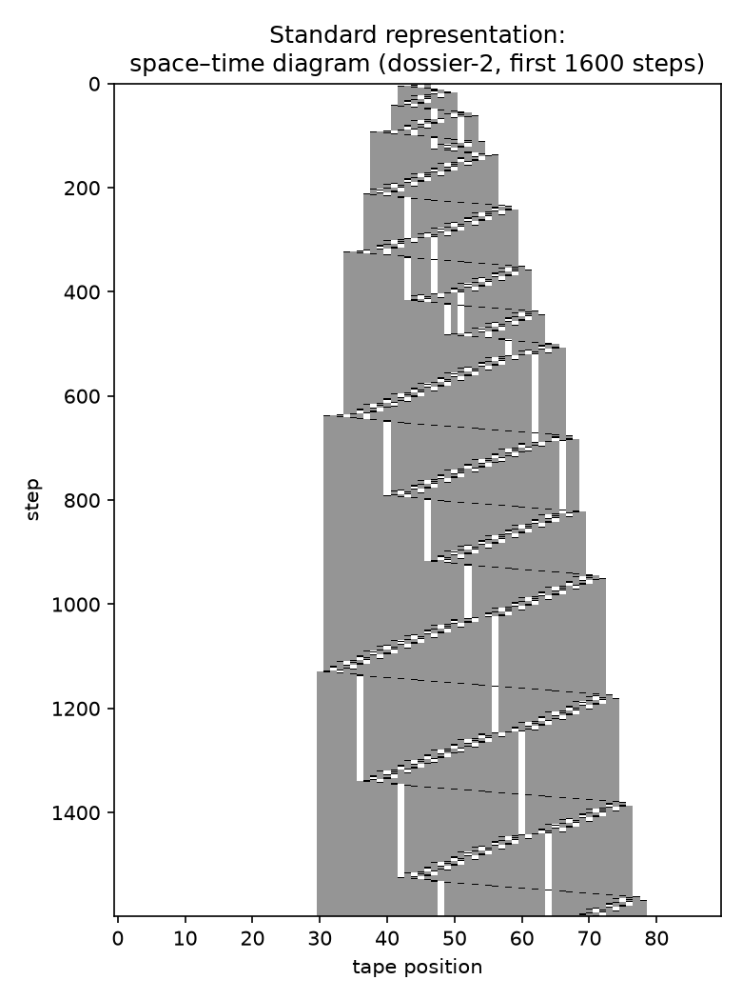
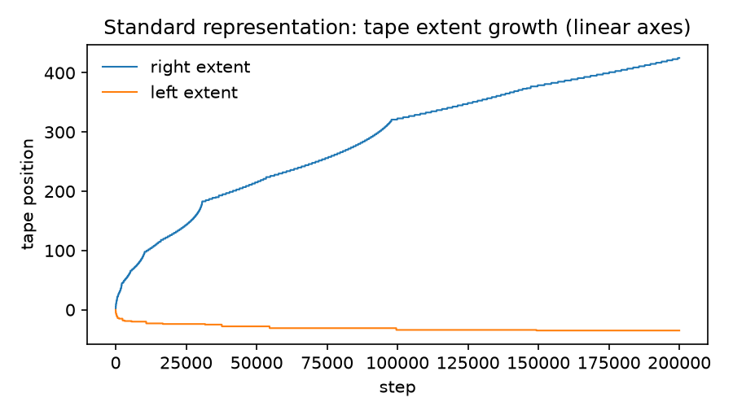
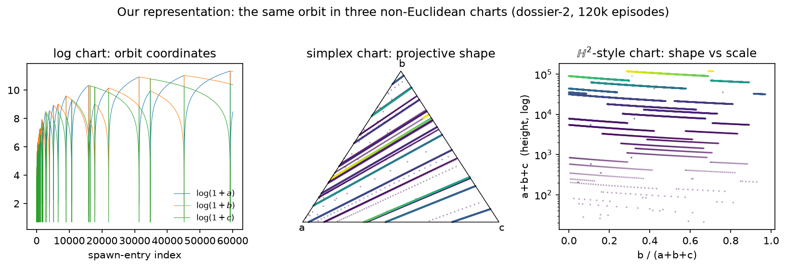
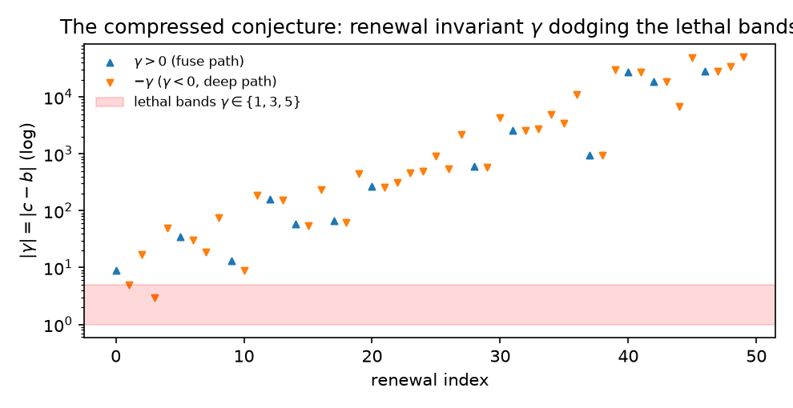

# Grounding the methodology: a literature review

**Date:** 2026-08-26 · **Figures:** `docs/learning/figures/fig{1..4}*.png`
(all generated from real dossier-2 data by
`scratchpad/make_figs.py`, reproducible from the repo's validated
`metaStep` mirror)

This document places the three pillars of our program — busy beaver
mathematics, Lean formalization in the Tao era, and the non-Euclidean
chart methods — in their actual literature, and shows with figures why
the chart representations earn their keep against the standard ones.

---

## 1. Busy beaver in the mathematics literature

The busy beaver function was introduced by **Tibor Radó (1962)**, "On
Non-Computable Functions" (*Bell System Technical Journal*), as the
cleanest concrete example of a well-defined but uncomputable function.
Milestones since:

- **Lin & Radó (1965)** settled BB(3); **Brady (1983)** settled BB(4);
  **Marxen & Buntrock (1990)** found the BB(5) champion whose
  47,176,870 steps stood unproven-maximal for 34 years.
- **Aaronson (2020)**, "[The Busy Beaver Frontier](https://www.researchgate.net/publication/349805758_The_Busy_Beaver_Frontier)"
  (SIGACT News) — the survey that framed BB as a barometer for the
  limits of mathematics (BB(748) is independent of ZFC via Riemann/
  consistency encodings) and directly inspired the bbchallenge
  collaboration ([Quanta's account](https://www.quantamagazine.org/amateur-mathematicians-find-fifth-busy-beaver-turing-machine-20240702/)).
- **The bbchallenge Collaboration (2024–2025)**:
  [BB(5) = 47,176,870, machine-checked in Rocq/Coq](https://arxiv.org/pdf/2509.12337)
  — 27,274 lines, 638 lemmas ([Aaronson's announcement](https://scottaaronson.blog/?p=8088),
  [Scientific American](https://www.scientificamerican.com/article/new-math-breakthrough-reveals-the-fifth-busiest-beaver/)).
  The companion [deciders paper](https://arxiv.org/pdf/2504.20563)
  systematizes the proof techniques (cyclers, translated cyclers,
  bouncers, closed tape languages).
- **The BB(6) frontier** ([wiki.bbchallenge.org](http://wiki.bbchallenge.org/))
  is guarded by "cryptids": machines like **Antihydra** whose halting
  encodes Collatz-like arithmetic. This is where our program lives —
  the 1,094-holdout classification, the four single-conjecture
  reductions, and the dossier-2/3 conditional closures.

**Where we sit:** our raw-TM layer is the Rocq tradition rebuilt in
core Lean 4 (validated by parser parity, differential traces, and a
zipper-tape bisimulation); our episode/orbit method is a certified,
generative descendant of the deciders paper's "closed tape language"
idea — but with the language *discovered empirically* and *compiled*
into kernel-checked theorems, rather than hand-designed.

The Collatz connection is not an analogy: **Tao (2019)**,
"[Almost all orbits of the Collatz map attain almost bounded values](https://arxiv.org/abs/1909.03562)",
is the state of the art for what *can* be proven about such maps —
measure-theoretic control, explicitly not pointwise. Our
`SafeMetaOrbit` conjectures are pointwise statements about a
*deterministic* five-integer map, which is exactly why they are sharp
and exactly why they are hard.

## 2. Lean, Tao, and Claude: the formalization era we're working in

- **The Equational Theories Project** (Tao, launched 2024-09-25;
  [project tour](https://terrytao.wordpress.com/2024/10/12/the-equational-theories-project-a-brief-tour/),
  [paper](https://arxiv.org/pdf/2512.07087)): 22 million implications
  between algebraic laws resolved by a human–AI–Lean pipeline; Claude
  and other LLMs co-wrote tooling, Lean checked everything. The
  methodological lesson we inherit: **the kernel is the trust surface;
  generators are labor.**
- **Tao formalizing with Claude Code**
  ([video discussion](https://news.ycombinator.com/item?id=47306852)):
  decomposition into steps beats monolithic prompts — precisely the
  architecture of our atom → episode → orbit compilers.
- **[Palomar](https://terrytao.wordpress.com/2026/08/18/palomar-a-registry-of-lean-verified-mathematics/)**
  (Tao et al., 2026-08-18; [about](https://palomar-registry.org/about)):
  the "preprint server for Lean proofs" — challenge files, solution
  modules, `formalization.yaml`, kernel replay. Our repo already
  packages three results in Palomar form; the axiom bar we enforce
  (`propext`, `Quot.sound` only) is stricter than Palomar's permitted
  set.
- **[Anthropic on Claude's mathematics](https://www.anthropic.com/research/riemann-zeta)**:
  the capability study backdrop for AI-assisted proof development.

**Where we sit:** this entire repo is an instance of the
Tao-era workflow — an AI assistant drives empirics and emits Lean; the
kernel arbitrates; humans own claims and scope. Our contribution to the
methodology is the **fail-closed generator–verifier loop**: the
empirical calculus refuses to classify anything it can't predict
exactly (episode-for-episode over 10⁹ raw steps), and only then is it
compiled to proofs.

## 3. Where the non-Euclidean charts come from

Our three chart maps have three distinct ancestries:

1. **The log chart** (`x ↦ log(1+x)` componentwise) is
   **Maslov–Litvinov dequantization / Viro's log-limit**
   ([Viro, "On basic concepts of tropical geometry"](https://www.math.u-bordeaux.fr/~ayger/DEA2012/Vir.pdf);
   [Litvinov's introduction](https://link.springer.com/article/10.1007/s10958-007-0450-5);
   [nLab](https://ncatlab.org/nlab/show/Maslov+dequantization)):
   polynomial/exponential structure becomes **piecewise-linear**
   ("tropical") in the log limit — exactly why our affine record
   dynamics appear as straight lines (Fig. 3, left) while the standard
   linear-axis picture (Fig. 2) shows only cramped curves.
2. **The simplex chart** (projective normalization
   `(a,b,c) ↦ (a,b,c)/(a+b+c)`) is the **Perron–Frobenius / Hilbert
   projective metric** tradition: quotient out overall scale, watch
   only *shape*. For a self-similar growth process the shape trajectory
   is the renormalized dynamics — our G-loops appear as straight
   simplex segments; renewals as jumps (Fig. 3, middle).
3. **The hyperbolic chart** (shape × log-scale as upper half-plane) is
   the geometry of hierarchies: **Nickel & Kiela (2017),
   "[Poincaré Embeddings](https://arxiv.org/abs/1705.08039)"** made
   this canonical in machine learning — trees embed with low distortion
   in negative curvature. Our orbit *is* a hierarchy (renewals nest
   generations of loops), so scale-as-height renders the eternal orbit
   as a walk in ℍ² (Fig. 3, right).

Beneath all three sits the **Turing-machines-as-dynamical-systems**
tradition: **Moore (1990/91)**, "Generalized shifts: unpredictability
and undecidability in dynamical systems" (*Nonlinearity*), and
**[Kůrka (1997), "On topological dynamics of Turing machines"](https://www.sciencedirect.com/science/article/pii/S0304397596000254)**
(*TCS*), with entropy follow-ups (Oprocha 2006, and the
[transitivity](https://link.springer.com/content/pdf/10.1007/978-3-662-48057-1_18.pdf)
literature). Treating a cryptid as an orbit in a state space — and
halting as reaching a *lethal set* — is this tradition; our incision
theorem (`eventSafe ⟺ safeOrbit`) makes the Poincaré-section idea
(sample the flow only at a transversal boundary) into a certified
equivalence.

## 4. The figures: standard vs chart representations

| | |
|---|---|
|  |  |

**Fig. 1 (standard: space–time diagram).** Dossier-2's first 1,600
steps. One sees *texture* — the caterpillar's serrated crawl — but no
structure that could be quantified, extrapolated, or certified.
**Fig. 2 (standard: growth curves).** Tape extents over 200k steps on
linear axes: monotone wedges. The self-similar renewal structure is
invisible.

**Fig. 3 (ours).** The same machine's abstract orbit (60,049
spawn-entries) in the three charts. Left: log chart — G-loops are line
segments (tropical piecewise-linearity of the affine episode maps);
renewals are the corners. Middle: simplex chart — scale is quotiented
away; the orbit's *shape* moves along straight rays between renewal
jumps; the lethal corners of parameter space are literal corners of the
triangle. Right: ℍ²-style chart — shape against log-scale (height);
the eternal orbit is an ascending zig-zag, one zig per renewal
generation.

**Fig. 4 (the compressed conjecture).** The renewal invariant
γ = c−b across the first 50 renewals: up-triangles (γ>0) exit via
fusion, down-triangles (γ<0) via deep renewal; the red band is the
**provably lethal** γ ∈ {1,3,5} (simulated corner states halt within
~50 steps). `SafeMetaOrbit` says this scatter never touches the band.
This single picture *is* dossier-2's halting problem.

## 5. Honest scope

- The charts are discovery instruments and exposition; **no theorem
  depends on them**. Everything certified is core-Lean over the raw
  machine.
- The literature positions are ours; none of the cited authors endorse
  this program.
- Figures are from the validated `metaStep` mirror (itself checked
  against 10⁹ raw steps), not from raw simulation at figure time —
  except Figs. 1–2, which are direct raw simulation.

## Sources

- Radó 1962, *Bell Syst. Tech. J.* — busy beaver introduced
- [Aaronson, The Busy Beaver Frontier (2020)](https://www.researchgate.net/publication/349805758_The_Busy_Beaver_Frontier)
- [bbchallenge Collaboration, Determination of BB(5) (arXiv:2509.12337)](https://arxiv.org/pdf/2509.12337)
- [bbchallenge, Turing machine deciders I (arXiv:2504.20563)](https://arxiv.org/pdf/2504.20563)
- [Aaronson's BB(5) announcement](https://scottaaronson.blog/?p=8088) · [Quanta](https://www.quantamagazine.org/amateur-mathematicians-find-fifth-busy-beaver-turing-machine-20240702/) · [SciAm](https://www.scientificamerican.com/article/new-math-breakthrough-reveals-the-fifth-busiest-beaver/) · [bbchallenge wiki](http://wiki.bbchallenge.org/)
- [Tao, Almost all Collatz orbits… (arXiv:1909.03562)](https://arxiv.org/abs/1909.03562) · [blog](https://terrytao.wordpress.com/2019/09/10/almost-all-collatz-orbits-attain-almost-bounded-values/)
- [Tao, Equational Theories tour](https://terrytao.wordpress.com/2024/10/12/the-equational-theories-project-a-brief-tour/) · [ETP paper (arXiv:2512.07087)](https://arxiv.org/pdf/2512.07087)
- [Tao, Palomar registry (2026)](https://terrytao.wordpress.com/2026/08/18/palomar-a-registry-of-lean-verified-mathematics/) · [palomar-registry.org/about](https://palomar-registry.org/about)
- [Tao + Claude Code formalization (HN)](https://news.ycombinator.com/item?id=47306852) · [Anthropic, Claude's mathematical capabilities](https://www.anthropic.com/research/riemann-zeta)
- [Nickel & Kiela, Poincaré Embeddings (arXiv:1705.08039)](https://arxiv.org/abs/1705.08039)
- [Viro, On basic concepts of tropical geometry](https://www.math.u-bordeaux.fr/~ayger/DEA2012/Vir.pdf) · [Litvinov, Maslov dequantization intro](https://link.springer.com/article/10.1007/s10958-007-0450-5) · [nLab: Maslov dequantization](https://ncatlab.org/nlab/show/Maslov+dequantization)
- Moore 1990/91, *Nonlinearity* — generalized shifts · [Kůrka, On topological dynamics of Turing machines (TCS 1997)](https://www.sciencedirect.com/science/article/pii/S0304397596000254)
